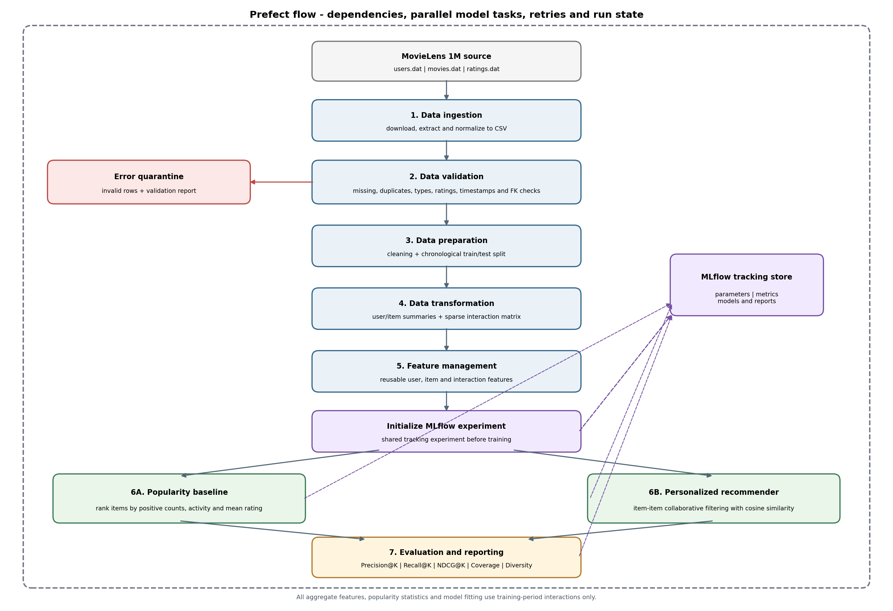

# End-to-End Recommendation Data Management Pipeline (DML Assignment 2)

A modular MovieLens recommendation pipeline covering ingestion, automated data validation, chronological preparation, transformations, reusable feature management, two recommendation models, MLflow tracking, ranking evaluation, report generation and Prefect orchestration.

**ingestion → validation → preparation → transformation → feature management → model training → evaluation**,
orchestrated with **Prefect** and tracked with **MLflow**.



## 1. Project choice and dataset

**Domain:** Movie recommendation.

**Dataset:** [MovieLens 1M](https://grouplens.org/datasets/movielens/1m/) from GroupLens. The stable release contains 1,000,209 ratings from 6,040 users across approximately 3,900 movies. It provides three related entities:

- `users.dat`: user ID, gender, age-group code, occupation code and ZIP code.
- `movies.dat`: movie ID, title and pipe-separated genres.
- `ratings.dat`: user ID, movie ID, whole-star rating (1–5) and Unix timestamp.

The source files use `::` delimiters. The ingestion stage downloads and extracts the original files and normalizes them to CSV under `data/raw/normalized/`. The original MovieLens data is not committed to Git because the dataset README prohibits redistribution without separate permission. Review the [dataset README and usage terms](https://files.grouplens.org/datasets/movielens/ml-1m-README.txt) before using it. The project code downloads the dataset directly when it is not already present.

The `age_group_code` column is a bucket code (for example, 18 means the 18–24 range), not an exact age. It is preserved as provided by the dataset.

## 2. Architecture

The Prefect flow executes these dependent stages using explicit Prefect `wait_for` edges. The popularity and personalized training tasks branch in parallel after feature generation and MLflow experiment initialization:

1. **Ingestion:** download/extract MovieLens and normalize users, items and ratings to CSV.
2. **Validation:** check required/missing fields, duplicate keys, data types, rating range, timestamp validity and referential integrity. Invalid rows are quarantined in `data/errors/`; valid rows continue.
3. **Preparation:** clean validated data and apply a global chronological split. The configured training fraction is 80%; rows at the cutoff timestamp are assigned to train, so ties can make the realized percentage differ slightly.
4. **Transformation:** create user activity and item popularity summaries plus a sparse explicit-rating user-item matrix (`.npz`). A zero in the sparse matrix means no recorded rating, not a zero-star rating. If a user has multiple training events for the same item, the matrix stores their mean rating.
5. **Feature management:** create reusable user, item and training-interaction feature tables. All aggregate features are calculated from training interactions only to avoid test-period leakage; the inference helper retrieves the persisted user/item feature tables when returning recommendations.
6. **Experiment tracking and training:** initialize the MLflow experiment, then train a popularity baseline and a personalized item-item collaborative-filtering model in parallel.
7. **Evaluation:** compare Precision@5, Recall@5, NDCG@5, catalog Coverage and genre-based Diversity. The K value is configurable as 5 or 10.
8. **Reporting:** comparison tables, recommendation lists, a JSON summary and a PDF report.

See [`reports/architecture.png`](reports/architecture.png) and [`reports/architecture.mmd`](reports/architecture.mmd).

## 3. Model and evaluation design

### Relevance definition

A held-out interaction is considered relevant when its rating is greater than or equal to `data.positive_rating_threshold` (default `4.0`). This is an explicit and configurable project assumption; the dataset contains 1–5 star ratings.

### Models

- **Popularity baseline:** items are ranked by positive training interaction count, total training interaction count and average training rating.
- **Personalized model:** item-item collaborative filtering. It computes cosine similarities between item vectors built from binary positive-rating user histories. A user's already-seen items are excluded from recommendation candidates. Popularity provides a fallback when a user has no positive training history and a deterministic tie-breaker.

### Ranking metrics

- **Precision@K:** relevant recommended items divided by K.
- **Recall@K:** relevant recommended items divided by the user's relevant held-out items.
- **NDCG@K:** ranking quality with logarithmic discount by rank.
- **Coverage:** unique recommended catalog items divided by the number of items with training interactions.
- **Diversity:** mean per-user intra-list Jaccard distance between movie genre sets. A larger value indicates more genre variety.

Precision, Recall and NDCG are macro-averaged over users. Evaluation users must have at least one positive test interaction for an item present in the training catalog and must have training history. Positive test events for items absent from the training catalog are counted in `evaluation_summary.json` as cold-start exclusions. This is reported explicitly because neither collaborative filtering model can recommend an item it has never seen.

The pipeline does not predict explicit star ratings.

## 4. Repository layout

```text
recommendation-pipeline/
├── configs/config.yaml
├── dags/recommendation_flow.py # Orchestration DAG/workflow file 
├── data/
│   ├── raw/                 # downloaded source + normalized CSVs 
│   ├── processed/           # valid, split and derived datasets 
│   ├── features/            # feature CSVs and sparse matrix 
│   └── errors/              # quarantined invalid rows 
├── models/                  # model artifacts and recommendation lists 
├── reports/
│   ├── architecture.mmd
│   ├── architecture.png
│   ├── feature_catalog.csv  # generated at runtime
│   ├── validation_report.json
│   ├── model_comparison.csv
│   └── final_report.pdf     # generated after a successful run
├── src/
│   ├── ingestion/
│   ├── validation/
│   ├── preparation/
│   ├── transformation/
│   ├── features/
│   ├── training/
│   ├── evaluation/
│   ├── reporting/
│   └── common/
├── scripts/smoke_test.py
├── tests/
├── requirements.txt
└── README.md
```

## 5. Results of the last run

<!-- RESULTS:START -->
*Last run (2026-11-11): time split at 2000-12-02T14:52:18+00:00, K = 5. Confidence intervals are in [reports/model_comparison.csv](reports/model_comparison.csv).*

| Model | Precision@5 | Recall@5 | NDCG@5 | Coverage@5 | RMSE | MAE |
| --- | --- | --- | --- | --- | --- | --- |
| Popularity baseline | 0.2316 | 0.0314 | 0.2417 | 0.0246 |  |  |
| Item-item collaborative filtering | 0.2483 | 0.0384 | 0.2624 | 0.1237 | 1.0714 | 0.8207 |
<!-- RESULTS:END -->


## 6. Setup (Windows PowerShell)

Use Python 3.10–3.13. From the repository root:

```powershell
py -3.11 -m venv .venv
.\.venv\Scripts\Activate.ps1
python -m pip install --upgrade pip
pip install -r requirements.txt
```

If PowerShell blocks virtual-environment activation, use the Python executable directly at `.venv\Scripts\python.exe`, or use an approved local execution policy.

## 7. Run the complete pipeline with Prefect

**Terminal 1 – start the local Prefect server/UI:**

```powershell
.\.venv\Scripts\Activate.ps1
prefect server start
```

**Terminal 2 – from the project root, point the flow to the local API and execute:**

```powershell
.\.venv\Scripts\Activate.ps1
$env:PREFECT_API_URL = "http://127.0.0.1:4200/api"
python -m dags.recommendation_flow
```

Open the Prefect UI at `http://127.0.0.1:4200` and inspect the successful flow run and individual task states. If you do not need the UI, the flow can also be run without starting the server; Prefect will use its local ephemeral mode.

### MLflow UI

After the pipeline has run, start a third terminal from the repository root:

```powershell
.\.venv\Scripts\Activate.ps1
mlflow ui --backend-store-uri sqlite:///mlflow.db --host 127.0.0.1 --port 5000
```

Open `http://127.0.0.1:5000` to inspect the experiment, parameters, metrics and artifacts. MLflow uses a sqlite database based tracking store.

## 8. Configuration

Edit `configs/config.yaml` before running:

| Setting | Default | Meaning |
|---|---:|---|
| `data.train_fraction` | `0.80` | Requested chronological training fraction |
| `data.positive_rating_threshold` | `4.0` | Rating threshold defining positive feedback |
| `evaluation.k` | `5` | Top-K ranking cutoff; use 5 or 10 |
| `evaluation.item_similarity_neighbors` | `100` | Maximum retained neighbors per item |
| `mlflow.enabled` | `true` | Enable local experiment logging |
| `report.generate_pdf` | `true` | Generate the final PDF report after evaluation |

All paths are resolved relative to the repository root.

## 9. Main generated outputs

| Artifact | Location |
|---|---|
| Normalized source tables | `data/raw/normalized/` |
| Invalid-record quarantine | `data/errors/invalid_*.csv` |
| Validation report | `reports/validation_report.json` |
| Chronological split | `data/processed/train_interactions.csv`, `test_interactions.csv` |
| User/item summaries | `data/processed/user_activity_summary.csv`, `item_popularity.csv` |
| Sparse user-item matrix | `data/features/user_item_ratings.npz` |
| User/item/interaction features | `data/features/` |
| Feature catalog | `reports/feature_catalog.csv` and `.md` |
| Model artifacts | `models/` |
| Model comparison | `reports/model_comparison.csv` |
| Evaluation details | `reports/evaluation_summary.json` |
| Final report | `reports/final_report.pdf` and `.md` |
| MLflow runs | `mlflow.db` |

## 10. Generate recommendations after training

Once the full Prefect flow has completed, generate recommendations for a user ID that exists in the MovieLens user table:

```powershell
python scripts/recommend_for_user.py --user-id 1 --model personalized --k 5
```

To run the global baseline instead:

```powershell
python scripts/recommend_for_user.py --user-id 1 --model popularity --k 5
```

A user with no training history receives popularity-based fallback recommendations. Already-seen items are excluded when training history exists. The prediction helper reads the persisted user/item feature tables to enrich each recommendation with the user's preferred category and item metadata/popularity features.

## 11. Tests and offline smoke test

To run unit tests:

```powershell
pytest -q
```

To run a small synthetic-data smoke test without downloading MovieLens, starting Prefect or enabling MLflow:

```powershell
python scripts/smoke_test.py
```

The smoke test validates the data-stage/model/evaluation/prediction code path using a temporary, small fixture dataset. It does not replace the full MovieLens execution.

## 12. Limitations

- The dataset is historical and contains ratings from MovieLens users who joined in 2000; it is a benchmark, not a representation of current movie preferences.
- New users and items are cold-start cases for the collaborative-filtering model.
- Positive relevance is defined by a rating threshold, which may not capture every user's subjective preference.
- The personalized model uses collaborative signals; movie genres are used for diversity measurement and user preference features, not as the collaborative model's similarity input.
- A global chronological split can produce a realized train percentage slightly different from the configured ratio when many events share the cutoff timestamp.

## References

- GroupLens, [MovieLens 1M dataset page](https://grouplens.org/datasets/movielens/1m/).
- GroupLens, [MovieLens 1M README and usage terms](https://files.grouplens.org/datasets/movielens/ml-1m-README.txt).
- Harper, F. M. and Konstan, J. A. (2015). *The MovieLens Datasets: History and Context*. ACM Transactions on Interactive Intelligent Systems, 5(4), Article 19. https://doi.org/10.1145/2827872
- [Prefect documentation](https://docs.prefect.io/).
- [MLflow Tracking documentation](https://mlflow.org/docs/latest/ml/tracking/).
